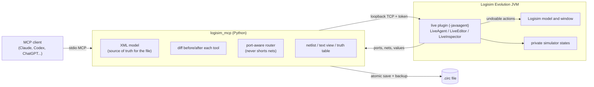

# Architecture

## Responsibilities

| Part | Does |
|---|---|
| `service.py` | One open project, allowlisted paths, atomic saves with backups, the live binding, `edit()` which diffs every tool call and mirrors it into the window |
| `live_sync.py` | Snapshot/diff of the XML model; protocol calls (APPLY, EXPORT, SAVED, INSPECT, SIMULATE...) |
| `geometry.py` | Exact component geometry from Logisim (cached), port references (`G1.in2`, `U1.pin13`), connectivity with Logisim's rules |
| `layout.py` | Orthogonal A* router (strict mode: no accidental connections; taps existing wires of the same net) and layout scoring |
| `views.py` | Text netlist, character drawing, truth tables |
| `runner.py` | Launching Logisim with the plugin, reusing a running window, headless test vectors and validation |
| `LiveAgent.java` | Loopback server, token check, archiving stale autosaves, open/reload/focus |
| `LiveEditor.java` | Applies diffs as `CircuitMutation`/`LogisimFileActions`, revision tracking, verify-and-mark-clean after saves |
| `LiveInspector.java` | Catalog, describe, netlist and diagnostics, private simulation, driving window inputs |

## Consistency model

- The bridge's XML model is what gets written to disk. Each edit is applied there first,
  then mirrored into the window as one undoable action; if Logisim rejects it, both sides
  roll back.
- Every change in the window bumps a revision counter; changes not made by the bridge
  (drawing, Ctrl+Z) are *external*. An edit carrying an outdated external revision is
  refused, the bridge pulls the window's state through Logisim's writer, and replays it.
- After a save, the plugin compares the window with the saved state (components by type,
  place and parsed properties; wires as merged geometry). If they match, the window is
  marked clean; otherwise it is reloaded from the file.

See [logisim-source-notes.md](logisim-source-notes.md) for the Logisim APIs involved.
